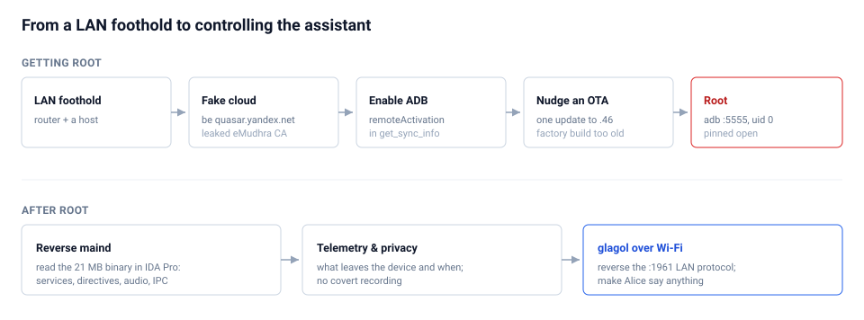
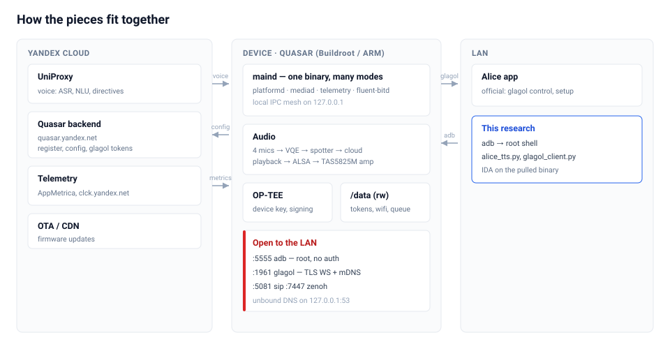

# Yandex Station Lite — IoT Security Research

End-to-end security research on a **Yandex Station Lite** (Alice) smart speaker, carried
out on my own device and network. The project goes the full distance: from **zero access**
to **persistent root**, through a **full reverse-engineering** of the device's "Quasar"
platform, to a **working exploit of the local control protocol** that makes the live
assistant speak and act on command over the LAN.

> ⚠️ **Scope & ethics.** All work was performed on hardware I own, on my own network, for
> learning and defensive research. No third-party device was touched and no firmware was
> redistributed. Live credentials, account identifiers, Wi-Fi secrets and the leaked CA
> material are **redacted/omitted** throughout (see *Responsible disclosure* below). Not
> affiliated with or endorsed by Yandex.

---

## Why this is interesting

- 🔓 **Root without flashing.** Persistent `uid=0` obtained purely in software by
  **MITM-ing the Quasar cloud config**: a leaked eMudhra/emSign CA ("eQuasar") lets a
  self-hosted server impersonate `quasar.yandex.net` and hand the speaker a config with
  `adbd.remoteActivation=true`. The device enables a **root network ADB** by itself.
- 🧩 **A non-obvious blocker, solved.** The 2021 factory firmware is *too old to activate*
  (it never calls `/get_sync_info`). Activation only completes after offering **exactly one
  OTA** to build `.46` — the last one that still trusts the eMudhra chain.
- 🧠 **The whole platform, reversed.** `maind` — a single 21 MB ARM binary that *is* the
  entire assistant (Quasar) — mapped in IDA Pro: service mesh, directive protocol, audio
  pipeline, telemetry, and the glagol LAN protocol.
- 📡 **Telemetry, to the byte.** What it stores, how it batches & gzip-queues on disk, when
  it flushes (204 800-byte cap / 6-min sync), how it is **signed with a device key**
  (`X-Quasar-Signature`), and what the backend can **retune remotely**. Includes the real
  decompressed event payloads.
- 🕵️ **Privacy, answered with evidence.** No continuous recording: wake-word is on-device,
  activation audio lives only in **encrypted RAM buffers**, and only a documented ~1 %
  "very-rare" spotter sample logs 5 s of audio.
- 🗣️ **Local control exploit.** The **glagol** protocol (`wss://…:1961`) fully reversed,
  including the privilege tiers and the `serverAction → BypassDirectiveHandler` path. Ships
  [`alice_tts.py`](06-glagol-protocol/alice_tts.py): make the live Alice **say arbitrary
  text** over the LAN. The device OAuth token is recovered on-device (we're root), so no
  app login is needed.

---

## The device

| | |
|---|---|
| Model | Yandex Station Lite — Quasar platform `yandexmicro` |
| OS | Buildroot Linux (BusyBox), kernel 4.9.68 aarch64, **not Android** |
| SoC / amp | Amlogic (quad-core) / TAS5825M |
| Userland | 32-bit ARM (armhf) on a 64-bit kernel |
| Core | `maind` (21 MB) — monolithic Quasar platform, built from Yandex Arcadia |

---

## Repository map

| Chapter | What's inside |
|---|---|
| [`01-gaining-root/`](01-gaining-root/) | How root was obtained: the [field report](01-gaining-root/field-report.md) (EN) and [writeup](01-gaining-root/writeup-ru.md) (RU), the cloud-config MITM [toolkit](01-gaining-root/toolkit/), the [DNS/stand scripts](01-gaining-root/mitm-stand/) and [helpers](01-gaining-root/helpers/). |
| [`02-device-dossier/`](02-device-dossier/) | Hardware, flash/U-Boot, [filesystem map](02-device-dossier/filesystem.md), [local & cloud endpoints](02-device-dossier/endpoints.md). |
| [`03-reversing-quasar/`](03-reversing-quasar/) | `maind` [binary analysis](03-reversing-quasar/binary-analysis.md), the Alice [directive/IPC protocol](03-reversing-quasar/directives-and-ipc.md), and the [IDA + MCP setup](03-reversing-quasar/ida-setup.md). |
| [`04-telemetry-and-privacy/`](04-telemetry-and-privacy/) | ⭐ Exhaustive [telemetry analysis](04-telemetry-and-privacy/telemetry.md) and the [privacy conclusion](04-telemetry-and-privacy/privacy.md). |
| [`05-audio-and-led/`](05-audio-and-led/) | The [audio stack](05-audio-and-led/audio.md) (incl. making it speak/play) and the [LED subsystem](05-audio-and-led/led.md) + `.led` file format. |
| [`06-glagol-protocol/`](06-glagol-protocol/) | ⭐ The [glagol protocol internals](06-glagol-protocol/internals.md), the [working TTS chain](06-glagol-protocol/live-tts.md), and the [`alice_tts.py`](06-glagol-protocol/alice_tts.py) tool. |
| [`00-overview/`](00-overview/) | Methodology, threat model, timeline. |
| `tools/`, `artifacts/` | Reusable tooling and small (non-sensitive) device artifacts. |

A good reading order: **00 → 01 → 02 → 03 → 04 → 05 → 06**.

---

## Headline results

| Area | Result |
|---|---|
| Access | Persistent root ADB (`uid=0`), survives reboot, DNS un-hijack, and Wi-Fi migration |
| Attack surface | ADB `:5555` (no auth), glagol `:1961`, SIP `:5081`, Zenoh `:7447` exposed on `0.0.0.0` |
| Hardening gaps | empty `root` password, no SELinux, Wi-Fi PSK + OAuth tokens in cleartext at rest |
| Telemetry | operational-only (no audio/transcripts), device-signed, remotely retunable |
| Local control | arbitrary TTS + directive injection over glagol (owner token), media/volume (guest) |

---

See the consolidated **[security findings register](SECURITY_FINDINGS.md)** for the
severity-rated summary with remediation.

## Tooling
`adb` · **IDA Pro 9.4 + ida-pro-mcp** (agent-driven reverse engineering) · Python
(`websockets`, `paramiko`) · `openssl`/`nginx` MITM stand · a BusyBox/armhf target with no
on-device debugger (everything pulled and analysed on the host).

## Responsible disclosure & redaction
This repository documents **method and mechanism**, not a weapon against other people's
devices. Removed/redacted: the account OAuth/x-tokens and glagol `conversationToken`, the
Wi-Fi PSK and SSID, device serial / MAC / account UID, device key hashes, and the **leaked
eMudhra CA private key** (the public eQuasar project is cited instead). Network ADB on this
firmware is unauthenticated — keep port 5555 on a trusted LAN.

## License
MIT — see [LICENSE](LICENSE). Research on the author's own device; not affiliated with Yandex.
